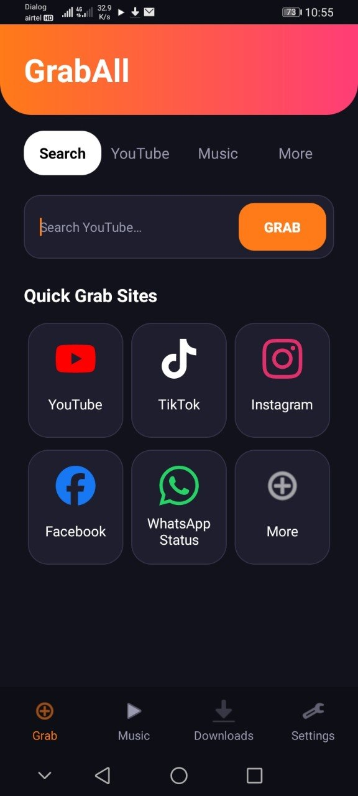
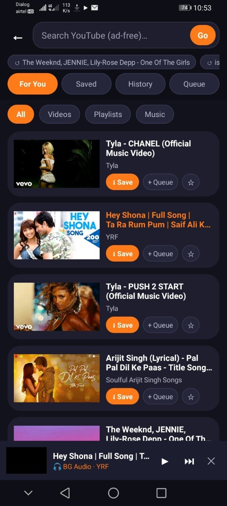
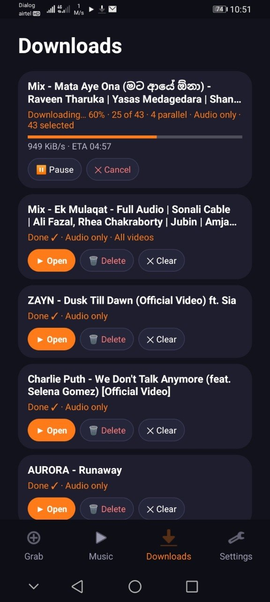
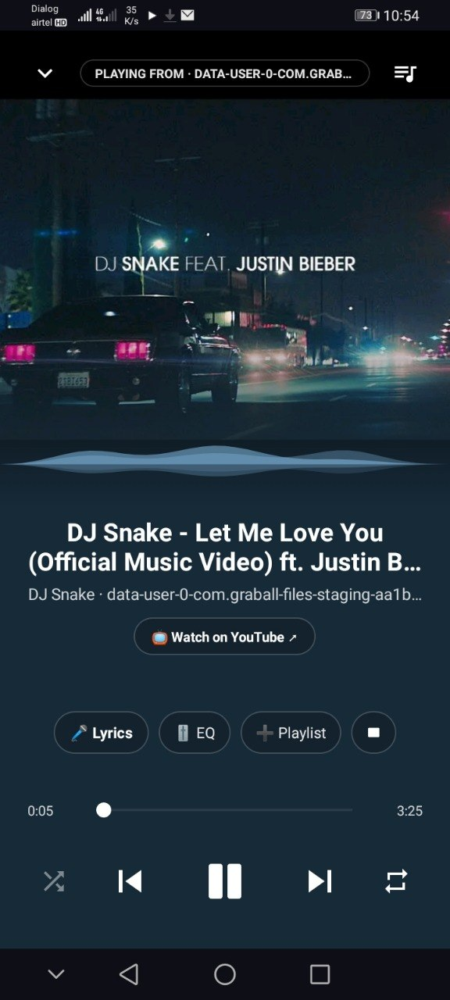
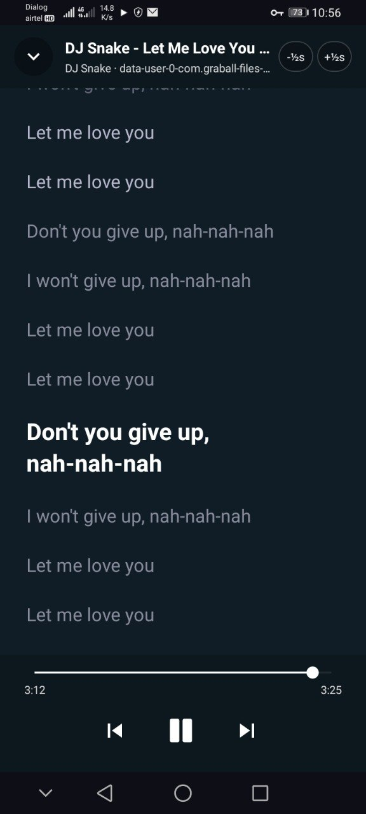
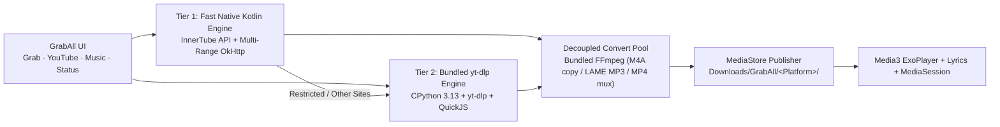

<div align="center">



<br/><br/>

[](https://github.com/Avishka-55/grab-all/releases/latest)
[](https://github.com/Avishka-55/grab-all/actions/workflows/android.yml)
[-22C55E?style=for-the-badge&labelColor=141625&logo=android&logoColor=white)](#download--install)
[](LICENSE)

<br/>

**A fast, privacy-first, all-in-one Android media downloader, ad-free YouTube client, offline Music Player with live synced lyrics, and WhatsApp Status saver.**  
*100% on-device · Zero ads · Zero servers · Zero tracking · Works on 32-bit ARMv7 & 64-bit ARM64*

<br/>

<a href="https://github.com/Avishka-55/grab-all/releases/latest">
  
</a>

</div>

---

## ✨ App Preview

<div align="center">
<table>
  <tr>
    <td align="center" width="20%">
      <br/>
      <sub><b>Quick Grab & Sites</b></sub>
    </td>
    <td align="center" width="20%">
      <br/>
      <sub><b>Ad-Free YouTube Feed</b></sub>
    </td>
    <td align="center" width="20%">
      <br/>
      <sub><b>Parallel Downloads</b></sub>
    </td>
    <td align="center" width="20%">
      <br/>
      <sub><b>Dynamic Music Player</b></sub>
    </td>
    <td align="center" width="20%">
      <br/>
      <sub><b>Live Synced Lyrics</b></sub>
    </td>
  </tr>
</table>
</div>

---

## 🚀 Key Features

<table>
<tr>
<td width="50%" valign="top">

### ⚡ High-Speed Download Engine
- **Unthrottled Multi-Connection Chunking:** Uses GoogleVideo's native `&range=start-end` (`1–2 MB` chunks) across parallel connections for **all** YouTube single videos, audio, and playlists.
- **Parallel Playlist Pipeline:** Downloads multiple tracks simultaneously (`Auto / 1–6` configurable in Settings) while encoding/muxing in a separate pool so Wi-Fi stays saturated.
- **Fast M4A (Default) & Universal MP3:** Zero-transcode `ffmpeg -c:a copy` M4A saves playlists ~10× faster with original AAC quality + embedded cover art & tags; switch to **MP3** anytime in Settings.
- **Interactive Playlist Item Picker:** Filter, search, and hand-pick exact songs or videos from any playlist before downloading.
- **Pause, Resume & Screen-Off Persistence:** Partial `.part` resume, `WakeLock` + `WifiLock`, and resilient network-blip recovery.
- **Multi-Site Support:** Powered by bundled **CPython 3.13 + `yt-dlp` + QuickJS + FFmpeg** for YouTube, TikTok, Instagram, Facebook, X, Reddit, SoundCloud, Vimeo, and 1000+ sites.

</td>
<td width="50%" valign="top">

### 📺 Ad-Free YouTube & Background Audio
- **Native InnerTube Client:** Zero WebView overhead, 100% ad-free feeds, search autocomplete, Trending, Music, and Playlists.
- **Private On-Device "For You" Feed:** Builds recommendations locally from your watch history, bookmarks, and searches — never uploaded to any server.
- **Background Audio & PiP:** True screen-off audio-only mode (stops downloading video frames when locked), Picture-in-Picture, playback speed, quality selector, and closed captions.
- **SponsorBlock Integration:** Automatically skips in-video sponsors and intros.
- **Watch or Listen from Any Pasted Link:** Paste any YouTube video or playlist URL on the home screen to **▶ Watch Playlist**, **☑ Select Items**, **▶ Watch Video**, or **🎧 Listen Audio** in one tap.

</td>
</tr>
<tr>
<td width="50%" valign="top">

### 🎵 Offline Music Player & Synced Lyrics
- **20+ Audio Formats:** Powered by **Media3 ExoPlayer** (with automatic `MediaPlayer` fallback for MIDI/OEM codecs): `MP3`, `M4A`, `M4B`, `AAC`, `FLAC`, `WAV`, `AIFF`, `ALAC`, `OGG`, `OPUS`, `WEBA`, `MKA`, `WMA`, `AMR`, `3GA`, `AC3`, `EAC3`, `MIDI`.
- **Dynamic Album-Art Theming:** Extracts dominant colors from embedded cover art with an animated audio waveform.
- **Live Synced Lyrics:** Real-time scrolling lyrics via LRCLIB with `-½s` / `+½s` sync adjustment and tap-to-seek.
- **Folders, Custom Playlists, Sort & Fast Scroller:** Internal + SD card scanning, smart recording-folder filtering, system equalizer link, Bluetooth/headset `MediaSession` controls, and **System Default Audio Player** support.
- **Local ↔ YouTube Bridge:** Tap **`📺 Watch on YouTube ↗`** on any local song (long-press for instant playback).

</td>
<td width="50%" valign="top">

### 📁 Clean Storage, WhatsApp Status & Self-Updater
- **Smart On-Demand Platform Folders:** Saves cleanly into `Downloads/GrabAll/` — creating subfolders only when you download from that platform:
  - `YouTube/Audio/`, `YouTube/Video/`, `YouTube/<Playlist Title>/`
  - `TikTok/`, `Instagram/`, `Facebook/`, `X/`, `Reddit/`, `SoundCloud/`, `WhatsApp Status/`, `Other/`
- **WhatsApp Status Viewer & Saver:** Smooth 60fps Images & Videos tabs with full-screen in-app preview before saving.
- **In-App `yt-dlp` Self-Updater:** Update `yt-dlp` directly from GitHub (Stable or Nightly) inside Settings whenever YouTube changes — no APK reinstall required.
- **Optional On-Device Cookies:** Import `cookies.txt` locally for private or age-restricted videos; cookies never leave your phone.

</td>
</tr>
</table>

---

## 📥 Download & Install

GrabAll is distributed directly via GitHub Releases (not on Google Play).

1. Open the **[Latest Release](https://github.com/Avishka-55/grab-all/releases/latest)** page.
2. Download `app-release.apk` (universal signed APK for both **ARM64** & **ARMv7 32-bit**).
3. Install the APK on your Android device *(allow "Install unknown apps" for your browser or file manager if prompted)*.

| Requirement | Details |
| :--- | :--- |
| **Android Version** | Android 5.0 (API 21) through Android 16 |
| **Architectures** | `arm64-v8a` (64-bit) & `armeabi-v7a` (32-bit) universal APK |
| **Account / Server** | None — 100% local on-device execution |

---

## 🏗️ Architecture



---

## 🛠️ Building from Source

### Prerequisites
- **JDK 17**
- **Gradle 8.9**
- **Android SDK** (`compileSdk 34`, `build-tools 34.0.0`, `minSdk 21`)

### Local Debug Build
```bash
git clone https://github.com/Avishka-55/grab-all.git
cd grab-all
gradle :app:assembleDebug
# Output: app/build/outputs/apk/debug/app-debug.apk
```

### CI / Release Signing
GitHub Actions ([`.github/workflows/android.yml`](.github/workflows/android.yml)) builds automatically:
- **Push / PR to `main`** → compiles debug APK to verify the build.
- **Tag `v*` (e.g., `v1.1.8`)** → builds signed release APK and publishes a GitHub Release.

Release APKs are signed only when these repository secrets are configured in **Settings → Secrets and variables → Actions**:
- `KEYSTORE_BASE64` — base64-encoded release `.jks` keystore
- `KEYSTORE_PASSWORD`, `KEY_ALIAS`, `KEY_PASSWORD`

Without those secrets, `assembleRelease` still succeeds and outputs an unsigned APK. Never commit keystores or passwords — `.gitignore` excludes `*.jks`, `*.keystore`, `keystore.properties`, and `local.properties`.

---

## 🙏 Open-Source Credits

GrabAll stands on the shoulders of great open-source projects:

- **[yt-dlp](https://github.com/yt-dlp/yt-dlp)** (Unlicense) — multi-site extraction engine & self-update target
- **[FFmpeg](https://ffmpeg.org/)** (LGPLv2.1+ / GPLv3) & **[LAME](https://lame.sourceforge.io/)** (LGPL) — audio/video muxing, cover-art embedding, and MP3/M4A processing
- **[CPython](https://www.python.org/)** (PSF License) — embedded Python 3.13 runtime for ARMv7 & ARM64
- **[QuickJS](https://bellard.org/quickjs/)** (MIT) — lightweight JS challenge solver for `yt-dlp`
- **[AndroidX Media3](https://github.com/androidx/media)** & **[OkHttp](https://square.github.io/okhttp/)** (Apache-2.0) — high-performance playback & HTTP networking
- **[SponsorBlock](https://sponsor.ajay.app/)** & **[LRCLIB](https://lrclib.net/)** — community sponsor segments & synced lyrics

---

## 📄 License

This project is licensed under the **GNU General Public License v3.0 (GPL-3.0)** — see the [LICENSE](LICENSE) file for details.

> **Disclaimer:** GrabAll is intended for personal, non-commercial use with content you have the right to download or access. Users are solely responsible for complying with applicable laws and platform terms of service.
